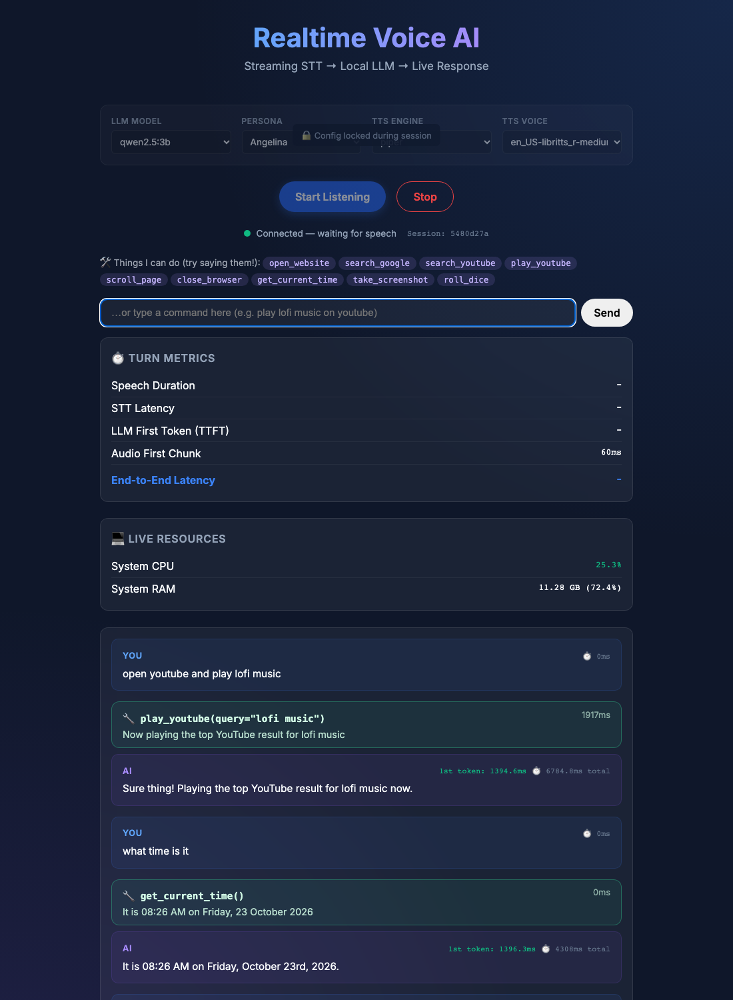
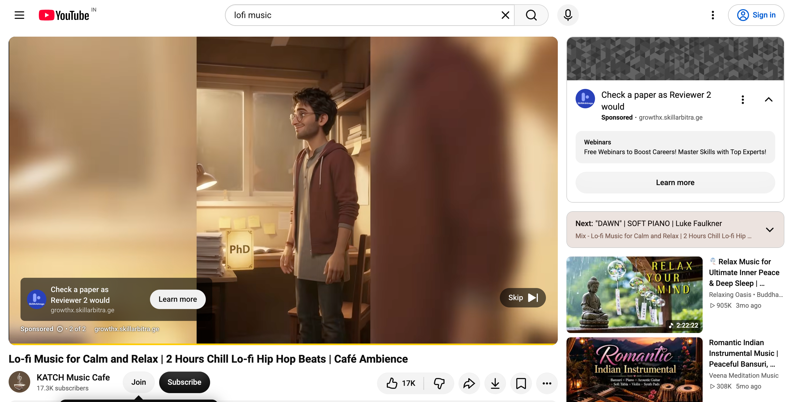

# 🎙️ Voice Agent That Acts — Workshop Starter

Talk to your computer. It **talks back** *and* **does things** — opens YouTube, plays a song, searches Google, scrolls, takes screenshots.

**100% local & open source:** faster-whisper (ears) · Ollama (brain) · Kokoro/Piper (voice) · Playwright (hands). No API keys, no cloud, no cost.



## What happens when you say "play lofi music on YouTube"

```
 🎤 You speak
   │
   ▼
 [1] EARS   faster-whisper turns audio into text           ~0.3 s
   │
   ▼
 [2] BRAIN  Ollama LLM is given the text + a list of tools.
   │        "Should I DO something?"  ──► play_youtube("lofi music")   ~0.5–2 s
   ▼
 [3] HANDS  Playwright opens Chromium and plays the video  ~2–3 s   ← the new part!
   │
   ▼
 [4] BRAIN  LLM says what it did: "Playing lo-fi music now!"   first words ~1.5 s
   │
   ▼
 [5] VOICE  Kokoro/Piper speaks it back through your speakers
```



> The part **we added** for this workshop is steps 2–3 + the action cards in the UI: the folder
> [`app/tools/`](app/tools). Everything else is the original voice pipeline.

---

## 🚀 Quick start — from zero (about 15 minutes, mostly downloads)

### Step 0 — Install the 4 basics (one time)
| Tool | Why | Mac | Linux (Ubuntu) | Windows |
|---|---|---|---|---|
| **Git** | get the code | `brew install git` | `sudo apt install git` | use **WSL2** (Ubuntu) and follow the Linux column |
| **Python 3.12** (3.11 also OK, **not 3.13+**) | runs the agent | `brew install python@3.12` | `sudo apt install python3.12 python3.12-venv` | in WSL |
| **Ollama** | the local AI brain | [ollama.com/download](https://ollama.com/download) | `curl -fsSL https://ollama.com/install.sh \| sh` | in WSL |
| **ffmpeg + espeak-ng** | audio helpers | `brew install ffmpeg espeak-ng` | `sudo apt install ffmpeg espeak-ng` | in WSL |

> Not sure you have them? `./setup.sh` checks everything and tells you exactly what's missing.

### Step 1 — Get the code
```bash
git clone https://github.com/coder-irwin/voice-agent-workshop.git
cd voice-agent-workshop
```

### Step 2 — Install everything (one command)
```bash
./setup.sh
```
Creates a Python environment, installs packages, the Playwright browser, the voice models, and pulls the AI model (~2 GB). Safe to re-run.

### Step 3 — Start the agent
```bash
./run.sh
```

### Step 4 — Talk to it
Open **http://localhost:8000** in Chrome → click **Start Listening** → allow the microphone → say *"open YouTube and play lo-fi music"*.
**Use headphones** — otherwise the agent hears its own voice (and your YouTube video!) and interrupts itself.

### Things to try saying
| Say… | It does… |
|---|---|
| "Open YouTube and play lo-fi music" | opens YouTube, plays the top result |
| "Search Google for open source voice agents" | Google search |
| "Open GitHub" | opens github.com |
| "Scroll down" | scrolls the page |
| "Take a screenshot" | saves `screenshots/shot_*.png` |
| "What time is it?" | tells you the time |
| "Roll a dice" | a tiny tool written by students 🎲 |
| "How are you?" | just chats — no tool is used |

### 🎙️ Three ways to talk to it (a laptop mic is NOT required)
| Option | How |
|---|---|
| **Microphone** | click *Start Listening* and speak |
| **No mic? Upload a voice file** | click *Start Listening* (it keeps working even if no mic is found), then use **🎧 Upload a voice file** — any wav/mp3/m4a, e.g. a recording from your phone |
| **Type it** | the text box under the status bar — same pipeline, great for a noisy room |

All three go through the exact same STT → tools → LLM → voice path. The agent always **speaks back** through your speakers.

---

## 🧪 Test without a microphone

```bash
.venv/bin/python try_tools.py "play lofi music on youtube"   # text -> tool (no audio at all)
.venv/bin/python voice_test.py "open github"                 # macOS speaks -> full voice pipeline -> ai_reply.wav
.venv/bin/python voice_test.py my_command.mp3                # any OS: send a recorded voice file (needs ffmpeg)
```

---

## ✏️ Add your own tool (this is the workshop exercise!)

Open [`app/tools/my_tools.py`](app/tools/my_tools.py) and add:

```python
@tool
def tell_joke() -> str:
    """Tell the user a programming joke."""
    return "Why do programmers prefer dark mode? Because light attracts bugs."
```

Restart `./run.sh`, then say **"tell me a joke"**. That's it — no other file to edit.

**The 3 rules**
1. Normal Python function + `@tool` on top.
2. Write a clear docstring — the AI reads it to decide **when** to use your tool.
3. Return a **short** string — the agent says it out loud.

Need the browser? `from .browser import browser` then `page = await browser.page()` (use `async def`). Copy `play_youtube` in `builtin.py` as a template.

Ideas: weather (`https://wttr.in/<city>?format=3`) · open Google Maps · play on Spotify web · translate a phrase · read the top news headline · open a specific GitHub repo.

---

## 🗺️ Where is everything?

```
voice-agent-workshop/
├── app/
│   ├── tools/                ← ⭐ THE ACTION LAYER (start here)
│   │   ├── registry.py       @tool decorator — turns a function into an AI-callable tool
│   │   ├── dispatcher.py     asks the LLM "which tool?", runs it
│   │   ├── browser.py        one shared Playwright browser
│   │   ├── builtin.py        open_website, play_youtube, search_google, scroll, screenshot…
│   │   └── my_tools.py       ✏️ YOUR playground
│   ├── main.py               WebSocket server: mic → STT → tools → LLM → TTS → speaker
│   ├── stt.py  llm.py  tts/  ears · brain · voice
│   └── vad.py                detects when you start/stop talking
├── index.html                the web UI (mic, chat, action cards)
├── setup.sh / run.sh         one-command install / start
├── try_tools.py              test tools by typing
└── voice_test.py             automatic voice-to-voice test
```

How tool calling works in one paragraph: we send Ollama your sentence **plus a menu of tools** (name, description, parameters — generated automatically from your function by `@tool`). If the model decides an action is needed it replies with a *tool call* instead of text; `dispatcher.py` runs the matching function (only registered tools can run — no shell access), and the result is handed to the LLM so its spoken reply matches reality.

## ⚙️ Settings (`.env`)
| Setting | Default | Meaning |
|---|---|---|
| `OLLAMA_MODEL` | `qwen2.5:3b` | the brain. `llama3.1:8b` is smarter but slower |
| `TOOLS_ENABLED` | `1` | `0` = chat only |
| `BROWSER_HEADLESS` | `0` | `1` hides the browser window |

## 🛟 Troubleshooting
| Problem | Fix |
|---|---|
| `No module named 'pkg_resources'` | `.venv/bin/pip install "setuptools<81"` |
| `webrtcvad` fails to install | You're on Python 3.13+. Use 3.11 or 3.12 |
| "Ollama isn't running" | open the Ollama app, or run `ollama serve` |
| "No microphone" message | expected on mic-less laptops or if permission was denied — upload a voice file or type instead |
| Agent keeps interrupting itself | use headphones; background noise counts as "you talking" |
| First command is slow | first run loads models & launches Chromium. Later commands are faster |
| Tool didn't trigger | check the docstring is clear; try `try_tools.py`; try `OLLAMA_MODEL=llama3.1:8b` |
| Wrong word heard | speak a little slower; small `base.en` Whisper is fast, not perfect |

## ⏱️ Measured on a MacBook (Apple Silicon, qwen2.5:3b)
| Step | Time |
|---|---|
| Speech → text | ~0.3 s |
| LLM decides the tool | 0.5–2 s |
| Tool runs (browser) | 0.2–3 s |
| First spoken word after you stop talking | ~3.8 s plain chat · ~4 s for a quick action (time, scroll) · ~6–8 s when a web page must load (YouTube) |

Want it faster? Use a smaller model, keep the browser open, or skip the router for chit-chat. (Great contribution idea!)

## 🤝 Contributing
See [CONTRIBUTING.md](CONTRIBUTING.md). Small PRs welcome — a new tool in `my_tools.py` is the perfect first one.

## 📚 Deep dive
Full docs for the underlying voice pipeline (VAD, memory, personas). *Written for the original repo — ignore its Docker and path instructions; use `./setup.sh` and `./run.sh` here*: [`docs/BACKEND_DEEP_DIVE.md`](docs/BACKEND_DEEP_DIVE.md).

Built on top of [coder-irwin/minimal-voice-ai-system](https://github.com/coder-irwin/minimal-voice-ai-system) · Apache-2.0.
